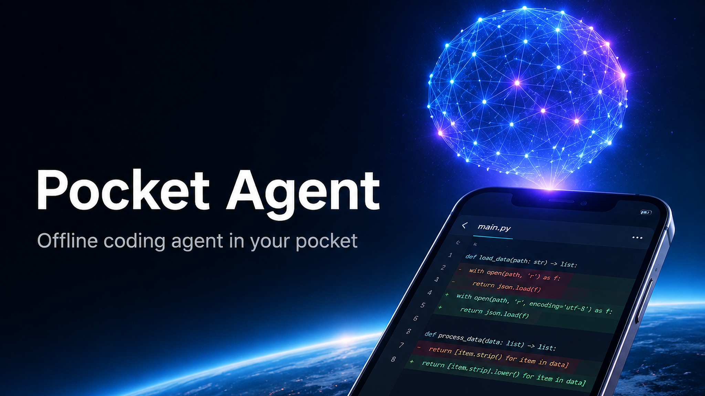
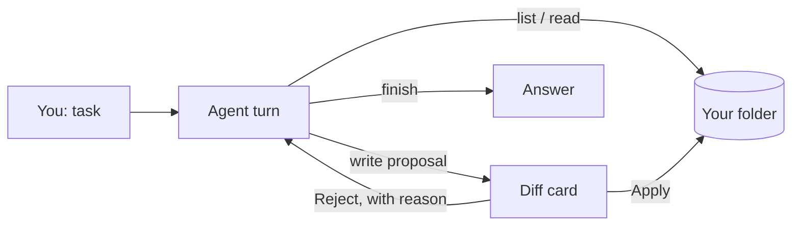

<p align="center">
  
</p>

<h1 align="center">Pocket Agent</h1>

<p align="center">
  <b>A coding agent that lives entirely on your iPhone.</b><br>
  A local Gemma model reads your project, proposes edits, and writes nothing until you say so.
</p>

<p align="center">
  
  
  
  
  
  
  
</p>

<p align="center">
  <a href="#quick-start">Quick start</a> ·
  <a href="#features">Features</a> ·
  <a href="#how-it-works">How it works</a> ·
  <a href="README.ru.md">Русский</a>
</p>

---

## At a glance

| 📱 Fully on-device | ✋ You approve every write | 🗂 Scoped to one folder |
|---|---|---|
| Gemma runs on the phone's GPU through LiteRT-LM. After the one-time model download, no network is needed. | Every file change arrives as a before/after diff card. Nothing touches disk until you tap **Apply**. | The agent only sees the folder you pick. Your files, tasks and chat never leave the device. |

```text
you    ▸ add a --verbose flag to cli.py
agent  ▸ list_files  → 12 files
agent  ▸ read_file   → cli.py
agent  ▸ write_file  → cli.py   ┌──────────────────────────────┐
                                │ - parser.add_argument("src") │
                                │ + parser.add_argument("src") │
                                │ + parser.add_argument("-v")  │
                                └──[ Reject ]──────[ Apply ]───┘
```

*Illustrative transcript of the agent loop, not a recording.*

## Why

Coding agents assume a laptop, a network and a very large model. Pocket Agent asks a different question: what is useful when the model is ~2B parameters and the machine is a phone on a train? The answer is short, one-step turns with a human in the loop, a tiny tool set that cannot do anything surprising, and a hard rule that a write needs your tap. It will not replace a frontier agent. It keeps your code on your device, and it works with no signal.

## Features

- 💬 **Chat on a project folder**: pick a folder from Files, ask for a change or an explanation
- 🔍 **Four actions only**: list files, read a file, write a file, finish
- ✅ **Diff approval**: every write is shown as before/after; a rejection is fed back so the model can try something else
- 🔒 **Offline by design**: files, tasks and chat stay on the phone
- 🧠 **Small-model aware**: short turns instead of pretending to be a long-horizon agent
- 📦 **Model manager**: download, import from Files, SHA-256 verification, memory check before load

## Requirements

| | |
|---|---|
| **Device** | iPhone with iOS 17+. The default Gemma 4 E2B build is listed in the app catalog for 8 GB RAM class devices (iPhone 15 Pro and newer) |
| **Storage** | ~2 GB for the model (~6 GB free while importing from Files) |
| **To build** | Mac, Xcode 26.2, [XcodeGen](https://github.com/yonaskolb/XcodeGen), Apple developer account |

> [!WARNING]
> **Tested on:** nothing in this release copy. **Not yet tested on:** any build or device. The repository was prepared for publication on a machine without Xcode, so the build steps come from the project's own configuration and have not been re-run. The 8 GB RAM figure is from the app's model catalog, not measured by the author. Expect to fix small things on the first build, and please open an issue.

## Quick start

```bash
brew install xcodegen
# edit project.yml: bundle id + your team id (see BUILD.md)
xcodegen generate && open PocketAgent.xcodeproj   # run on a physical iPhone
scripts/download-model.sh                         # optional: fetch the model on your computer
```

The app can also download the model itself on first launch. Full steps, including the optional native engines: [BUILD.md](BUILD.md).

## How it works



Each turn the model may call one of four tools. Reads and listings are free. A write is never executed directly: it becomes a proposal, rendered as a diff, and only your **Apply** writes the file. If you reject, the model sees that and proposes something else. The default engine is Google's LiteRT-LM running a Gemma 4 E2B build on the GPU.

## Experimental

The code base also contains parts that are not the focus of this release and are less polished. They are optional and off the main path.

- **Other engines**: MLX and llama.cpp-based runtimes next to the default LiteRT-LM
- **Remote providers**: optional, only if you configure them; this breaks the offline promise for that session
- **On-device image generation**: stable-diffusion.cpp based, needs extra native frameworks (see [BUILD.md](BUILD.md))
- **Web playground**: small pages and games generated by the model, run in the app with bundled offline libraries

## FAQ

<details>
<summary>Is the model included?</summary>

No. It is downloaded from Hugging Face on first launch, or with `scripts/download-model.sh`. Gemma 4 is published under Apache 2.0, see [THIRD_PARTY_NOTICES.md](THIRD_PARTY_NOTICES.md).
</details>

<details>
<summary>Can it run shell commands or touch other folders?</summary>

No. The tool set is listing, reading, writing and finishing, limited to the folder you picked.
</details>

<details>
<summary>Is the interface in English?</summary>

Not yet. The app's strings are currently in Russian; localization is a welcome contribution.
</details>

## Contributing

Issues and pull requests are welcome. Please keep changes small and describe how you tested them on a device.

## License

MIT, see [LICENSE](LICENSE). Third-party components and the model license: [THIRD_PARTY_NOTICES.md](THIRD_PARTY_NOTICES.md).

---

<p align="center">Made by <a href="https://github.com/meshoklv">@meshoklv</a></p>
