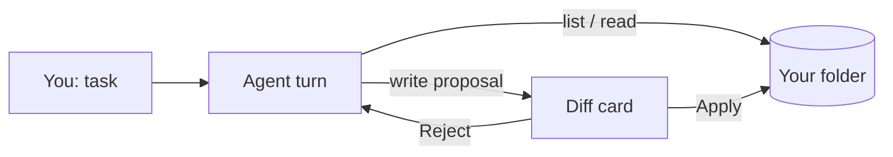

# Pocket Agent

[Русская версия](README.ru.md)


**A coding agent that lives entirely on your iPhone: a local Gemma model reads your project files and proposes edits — nothing is written until you tap Apply.**

## Why it's cool

- **Offline in your pocket.** The model runs on-device. After the one-time model download, no network is needed; your files, tasks and chat never leave the phone.
- **Safe by design.** The agent has four actions only: list files, read a file, write a file, finish. **Every write requires your confirmation** and is shown as a before/after diff. A rejection is fed back to the model so it can propose something else.
- **Scoped.** It can only touch the folder you explicitly pick.
- **Small-model aware.** A ~2B model can't sustain long autonomous tool chains, so the agent works as short, one-step turns with a human in the loop instead of pretending to be a long-horizon agent.

## Features

- Chat UI with project folder picker and diff approval card
- Model manager: download, import from Files, SHA-256 verification, memory check before load
- Several engines in the code: LiteRT-LM (default, Gemma), MLX, llama.cpp-based; optional remote providers; experimental image generation and an in-app web playground (these parts are experimental)

## Requirements

- iPhone with iOS 17+; the default Gemma 4 E2B build is listed in the app catalog as needing **8 GB RAM** class devices (e.g. iPhone 15 Pro and newer). *This is from the catalog, not tested by the release author.*
- ~2 GB for the model (~6 GB free while importing from Files)
- To build: Mac, Xcode 26.2, XcodeGen, Apple developer account

## Quick start

```bash
brew install xcodegen
# edit project.yml: bundle id + your team id (see BUILD.md)
xcodegen generate && open PocketAgent.xcodeproj   # run on a physical iPhone
scripts/download-model.sh                         # optional: fetch the model on your computer
```

Full steps: [BUILD.md](BUILD.md). **Status: this release copy has not been compiled** (no Xcode on the preparation machine).

## How it works



## License

MIT — see [LICENSE](LICENSE). The model is not included and has its own license; see [THIRD_PARTY_NOTICES.md](THIRD_PARTY_NOTICES.md).
