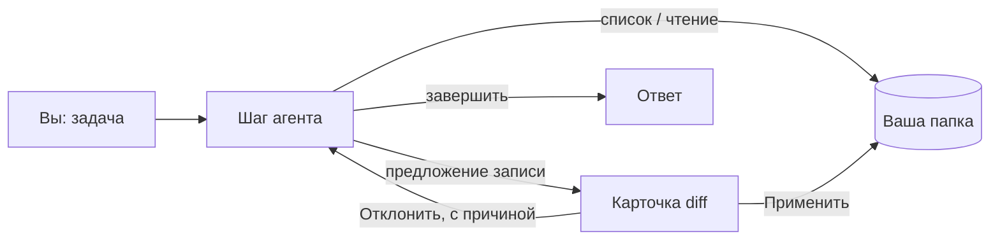

<p align="center">
  
</p>

<h1 align="center">Pocket Agent</h1>

<p align="center">
  <b>Кодинг-агент, который целиком живёт на iPhone.</b><br>
  Локальная модель Gemma читает проект, предлагает правки и ничего не пишет, пока вы не разрешите.
</p>

<p align="center">
  
  
  
  
  
  
  
</p>

<p align="center">
  <a href="#быстрый-старт">Быстрый старт</a> ·
  <a href="#возможности">Возможности</a> ·
  <a href="#как-это-устроено">Как устроено</a> ·
  <a href="README.md">English</a>
</p>

---

## Коротко

| 📱 Всё на телефоне | ✋ Каждая запись — с вашего «да» | 🗂 Только одна папка |
|---|---|---|
| Gemma работает на видеочипе телефона через LiteRT-LM. После разовой загрузки модели сеть не нужна. | Любая правка приходит карточкой «было/стало». На диск ничего не попадёт, пока вы не нажмёте **Применить**. | Агент видит только ту папку, которую вы выбрали. Файлы, задачи и переписка не покидают устройство. |

```text
вы     ▸ добавь флаг --verbose в cli.py
агент  ▸ list_files  → 12 файлов
агент  ▸ read_file   → cli.py
агент  ▸ write_file  → cli.py   ┌──────────────────────────────┐
                                │ - parser.add_argument("src") │
                                │ + parser.add_argument("src") │
                                │ + parser.add_argument("-v")  │
                                └──[ Отклонить ]──[ Применить ]┘
```

*Иллюстрация цикла работы агента, не запись экрана.*

## Зачем

Кодинг-агенты предполагают ноутбук, сеть и огромную модель. Pocket Agent задаёт другой вопрос: что полезно, когда модель на ~2 млрд параметров, а машина — телефон в метро? Ответ: короткие шаги с человеком в петле, крошечный набор действий, в котором нет сюрпризов, и жёсткое правило, что запись требует вашего нажатия. Флагманского агента он не заменит. Зато код остаётся на устройстве, и работает без связи.

## Возможности

- 💬 **Чат по папке проекта**: выбрали папку в «Файлах», попросили изменить или объяснить
- 🔍 **Всего четыре действия**: список файлов, чтение, запись, завершение
- ✅ **Подтверждение через diff**: любая запись показана как «было/стало»; отказ возвращается модели, и она предлагает другое
- 🔒 **Офлайн по построению**: файлы, задачи и переписка остаются на телефоне
- 🧠 **Честно про малую модель**: короткие шаги, а не притворство долгим автономным агентом
- 📦 **Менеджер моделей**: загрузка, импорт из «Файлов», проверка SHA-256, проверка памяти перед запуском

## Требования

| | |
|---|---|
| **Устройство** | iPhone, iOS 17+. Для сборки Gemma 4 E2B по умолчанию в каталоге приложения указан класс 8 ГБ ОЗУ (iPhone 15 Pro и новее) |
| **Память** | ~2 ГБ под модель (~6 ГБ свободно при импорте из «Файлов») |
| **Для сборки** | Mac, Xcode 26.2, [XcodeGen](https://github.com/yonaskolb/XcodeGen), аккаунт разработчика Apple |

> [!WARNING]
> **Проверено на:** ничём в этой копии релиза. **Не проверено на:** любой сборке и устройстве. Репозиторий готовили к публикации на машине без Xcode, поэтому шаги сборки взяты из конфигурации проекта и заново не прогонялись. Цифра 8 ГБ ОЗУ — из каталога моделей приложения, автор её не мерил. На первой сборке возможны мелкие поправки; заведите issue.

## Быстрый старт

```bash
brew install xcodegen
# отредактируйте project.yml: bundle id и ваш team id (см. BUILD.md)
xcodegen generate && open PocketAgent.xcodeproj   # запуск на реальном iPhone
scripts/download-model.sh                         # по желанию: скачать модель на компьютер
```

Приложение умеет качать модель само при первом запуске. Полные шаги, включая необязательные нативные движки: [BUILD.md](BUILD.md).

## Как это устроено



На каждом шаге модель может вызвать одно из четырёх действий. Чтение и список бесплатны. Запись никогда не выполняется напрямую: она становится предложением, показанным как diff, и файл пишет только ваше **Применить**. Если вы отклонили, модель видит это и предлагает другое. Движок по умолчанию — LiteRT-LM от Google, модель Gemma 4 E2B на видеочипе.

## Экспериментальное

В коде есть части, которые не главные в этом релизе и сделаны менее аккуратно. Они необязательны и лежат в стороне от основного пути.

- **Другие движки**: MLX и среды на основе llama.cpp рядом с LiteRT-LM по умолчанию
- **Удалённые провайдеры**: только если вы сами их настроите; на это время офлайн-обещание не действует
- **Генерация картинок на телефоне**: на основе stable-diffusion.cpp, нужны дополнительные нативные библиотеки (см. [BUILD.md](BUILD.md))
- **Веб-площадка**: небольшие страницы и игры, которые делает модель; запускаются в приложении со вшитыми офлайн-библиотеками

## Частые вопросы

<details>
<summary>Модель входит в репозиторий?</summary>

Нет. Её скачивают с Hugging Face при первом запуске или через `scripts/download-model.sh`. Gemma 4 выпущена под Apache 2.0, см. [THIRD_PARTY_NOTICES.md](THIRD_PARTY_NOTICES.md).
</details>

<details>
<summary>Может ли агент выполнять команды или трогать другие папки?</summary>

Нет. Только список, чтение, запись и завершение, и только в выбранной папке.
</details>

<details>
<summary>Интерфейс на английском?</summary>

Пока нет: тексты приложения сейчас на русском. Локализация — желанный вклад.
</details>

## Участие

Issues и pull requests приветствуются. Держите изменения небольшими и опишите, как проверяли на устройстве.

## Лицензия

MIT, см. [LICENSE](LICENSE). Сторонние компоненты и лицензия модели: [THIRD_PARTY_NOTICES.md](THIRD_PARTY_NOTICES.md).

---

<p align="center">Сделал <a href="https://github.com/meshoklv">@meshoklv</a></p>
